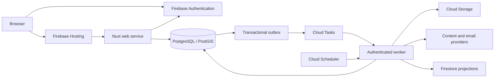

# Architecture overview

If you're getting to know Idea Map or deciding where a change belongs, start
here. You'll see how the app's parts fit together, how an idea moves from
submission to publication, and where to find more detail.

The following contents links navigate within this guide:

- [System and data flow](#system-and-data-flow)
- [Workspace boundaries](#workspace-boundaries)
- [Environments and recovery](#environments-and-recovery)
- [Asset provenance](#asset-provenance)
- [Platform guides](#platform-guides)

## System and data flow

Firebase Hosting serves static assets and forwards application requests to the
Nuxt web service on Cloud Run. Nuxt uses server-side rendering (SSR) for public
idea pages and social metadata. PostgreSQL with PostGIS is authoritative;
Firestore contains narrowly scoped real-time projections rather than a second
authoritative content store.

When someone submits or edits an idea, the app stores that exact revision and
its consent record privately. Assessment and review follow the
[moderation policy](../policies/moderation-policy.md). Only the approved
revision and permitted media become public. Access to private contact
information and review records requires server authorization.

The database records each durable change and its outbox work in the same
transaction. Idempotent handlers avoid repeating side effects during retries,
and hourly reconciliation repairs missed dispatch. Replacement, withdrawal, and
removal invalidate public projections, previews, and caches. The
[API policy](../policies/api-policy.md) defines request, session, authorization,
and retry requirements.

## Workspace boundaries

You can use this directory map to find application code, reusable packages, and
development tools:

| Location | Responsibility |
| --- | --- |
| `apps/web` | Nuxt SSR, browser UI, and same-origin API endpoints |
| `apps/worker` | Authenticated background task execution and reconciliation |
| `packages/contracts` | Shared types without framework or provider globals |
| `packages/server` | Server-only schema, database access, and integrations |
| `packages/street-renderer` | Independent street-diagram core with explicit inputs and provenance |
| `packages/streetmix` | Independent generation contracts and injected provider adapters |
| `infra/terraform` | Infrastructure definitions and validation |
| `dev` and `scripts` | Local services, development helpers, and test harnesses |

Reusable package cores must not import applications, server integrations, or
framework globals. Provider clients and configuration must enter through
explicit interfaces. Applications must consume public package exports rather
than private source paths; [Node.js and TypeScript](nodejs-typescript.md)
defines the build boundary.

## Environments and recovery

Local development uses synthetic data and emulators. Hosted development and
production have separate projects, origins, identities, databases, queues,
media, secrets, provider keys, and authentication configuration. Developers
should use individual short-lived development credentials; production operators
should use named, audited, time-limited access.

The system must keep production personal data, credentials, and backups out of
development, fixtures, continuous integration (CI) logs, and local machines.
Infrastructure operators should manage only explicitly owned resources and
preserve unrelated projects and data. Resource names such as `idea-map-dev` and
`idea-map-prod` describe environment roles; operators should verify actual names
and ownership before use.

The recovery objectives are at most 24 hours of data loss and 24 hours of
downtime. Operators should rehearse restoration into an isolated environment
against both objectives and record the recovery owner. Daily backups retain
seven copies, subject to privacy retention and legal-hold requirements;
restoration must not republish removed content.

## Asset provenance

The application must exclude rail feeds and transit logos whose permissions are
unverified. Maintainers should retain source-specific owner, license,
permission, attribution, modification, and redistribution records for copied
assets and data. Visible attribution and shipped license and `NOTICE` texts must
accompany material where its terms require them; a filename or package metadata
alone does not establish permission. Project software licensing does not cover
third-party content or marks.

## Platform guides

For details about a platform, you can start with these guides:

| Area | Guides |
| --- | --- |
| Runtime and workspace | [Node.js/TypeScript](nodejs-typescript.md), [pnpm](pnpm.md), [Vue/Nuxt](vue-nuxt.md) |
| User interface and verification | [Reka](reka.md), [Storybook](storybook.md), [Playwright](playwright.md), [design system](../design/design-system.md) |
| Local and hosted infrastructure | [Docker](docker.md), [Google Cloud](google-cloud.md), [Terraform](terraform.md) |
| Identity and storage | [Firebase](firebase.md), [PostgreSQL with PostGIS/Drizzle](postgresql-postgis-drizzle.md), [Neon](neon.md) |
| External services | [Resend](resend.md), [Streetmix](streetmix.md) |

You should follow the
[development guide](../contributor-guides/development-guide.md) for setup and
daily work and the [testing guide](../contributor-guides/testing-guide.md) for
checks. Platform guides explain how the pieces work together; the contributor
guides have the steps for running them.
